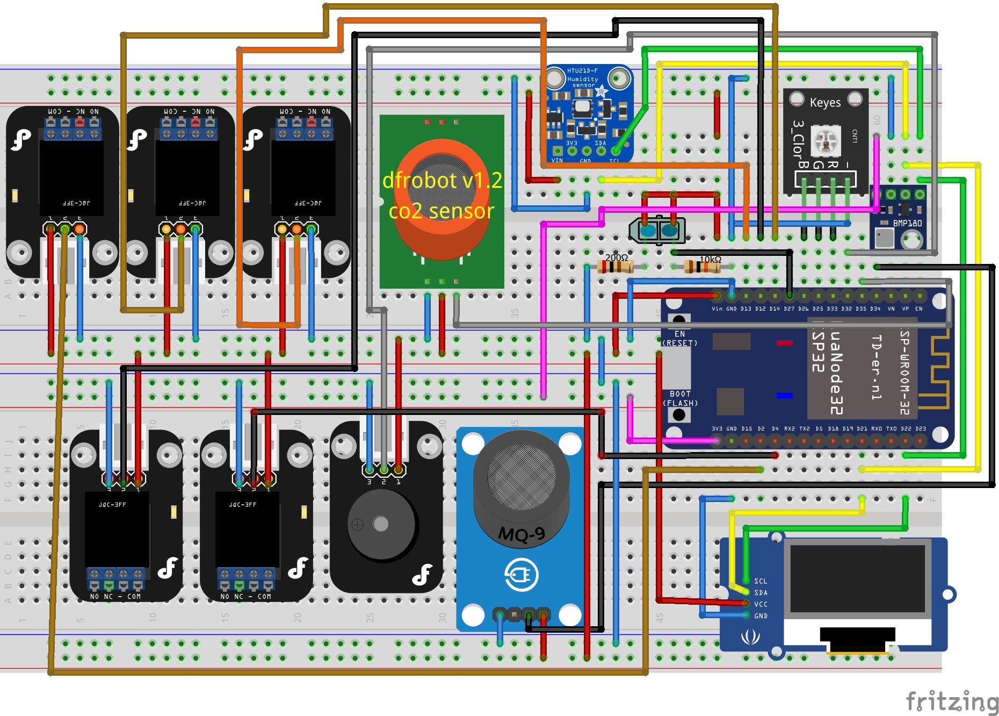
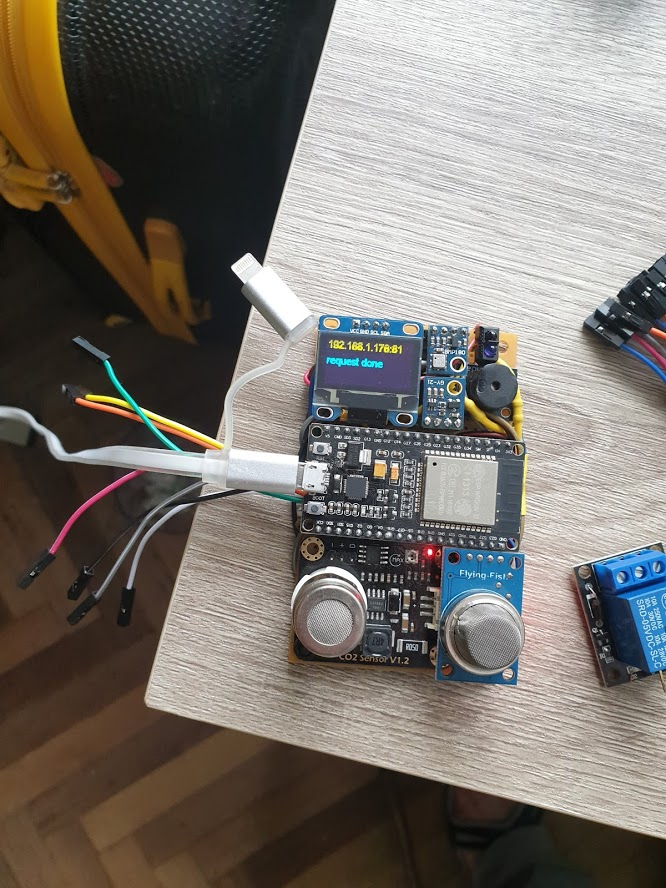
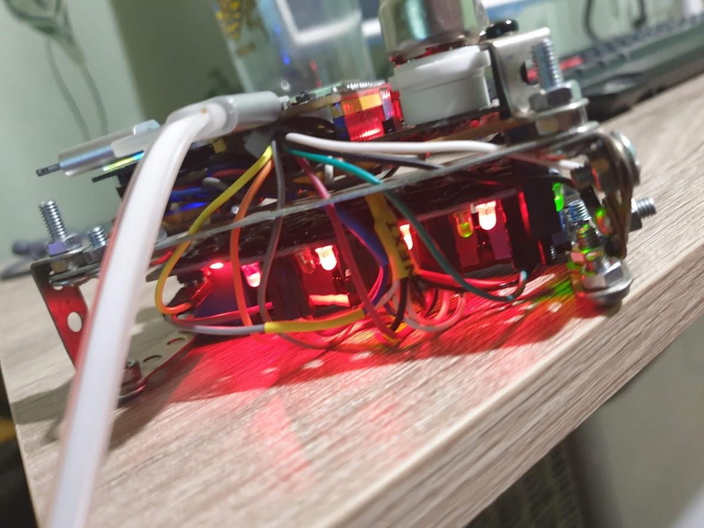
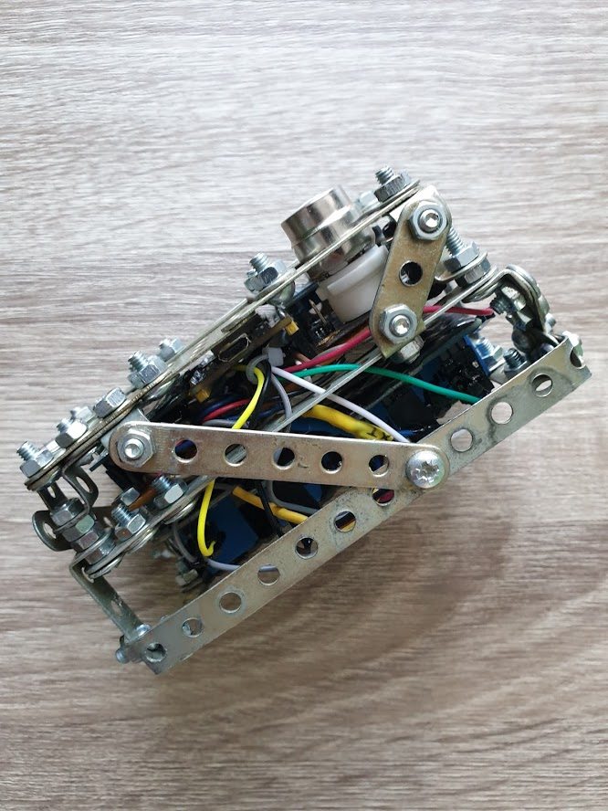

# Smart Place Guard
Smart Place Guard is an all-in-one smart environment controller. It monitors your room's air quality, temperature, and humidity, displays live data on a built-in screen, and lets you remotely control heavy-duty equipment like fans, heaters, or lights using 5 independent relays.

### What it does for you:
* **Real-time Air Quality & Climate Monitoring:** Tracks $CO_2$ levels, flammable gas leaks, precise atmospheric pressure, temperature, and humidity.
* **Smart Local Control:** Automatically triggers actions or lets you switch 5 different relays on/off instantly via a built-in web server or a local physical button.
* **Remote Management (REST API):** Connects to your Wi-Fi network so you can pull live sensor stats as JSON data or change relay states straight from your phone, computer, or home automation system.
* **Rock-Solid Stability:** Built with advanced error-protection (such as an automatic I2C recovery watchdog and filtered analog inputs) to keep the system running 24/7 without crashing or freezing.

## Hardware
Here is schema for creating device based on fritzing:

Every element has self identification and you can very easy find where you can get this specific element, also you can see [schema in .fzz](/fritzing/main.fzz)

### Hardware Assembly & Wiring Guidelines
* **Power Distribution & Rail Stability:** The system is engineered to run on a stable external 5V power supply. Due to the high current spikes drawn by the CO2 sensor heater and the 5-channel relay module, ensure your main 5V and GND lines use thick gauge wires. Avoid daisy-chaining power paths to prevent voltage drops that can distort analog sensor readings.
* **Analog Signal Integrity (CO2 & Gas Sensors):** The MG-811 ($CO_2$) and MQ-9 (Gas) sensors output analog signals connected to the ESP32's ADC pins (GPIO 35 and GPIO 34). Because analog lines are prone to electromagnetic interference (EMI), route these wires away from high-voltage relay switching lines and AC mains cables. 
* **Relay Isolation & Back-EMF Protection:** The 5-channel relay board (KY-019 style) handles heavy inductive loads. Ensure the relay board's optocoupler and VCC/GND lines are properly separated or robustly decoupled if sharing the power rail, preventing inductive kickback from resetting the ESP32 microcontroller during relay toggling.
* **I2C Bus Layout (BMP085 & HTU21D):** Both sensors share the I2C bus (SDA: GPIO 21, SCL: GPIO 22). Keep the total trace/wire length as short as possible (under 20-30 cm) and ensure proper pull-up resistors (typically 4.7kΩ) are present on both SDA and SCL lines to guarantee clean signal rise times and prevent bus lockups.
* **Physical Mounting & Thermal Management:** The MG-811 $CO_2$ sensor relies on an internal heating element to maintain its operating temperature. Ensure adequate physical clearance around the sensor module in your enclosure so heat dissipates safely without affecting nearby sensitive components like the HTU21D temperature/humidity sensor.

## Software

### Installation Environment
To set up your development and flashing environment for the Smart Place Guard, follow these step-by-step instructions:
1. **Install Board Drivers:** Install the necessary USB-to-UART bridge drivers (such as CP210x or CH340, depending on your specific NodeMCU/ESP32 board variant) located in the `install/windows/` directory (or select the appropriate package matching your operating system).
2. **Install Espruino IDE:** Install the Espruino IDE package provided inside the `install/windows/` folder to get your programming workspace ready.
3. **Flash Espruino Firmware:** Connect your assembled Smart Place device to your computer via USB. Navigate to the official [Espruino ESP32 Guide](https://www.espruino.com/ESP32) to flash the firmware. You can use their convenient online flashing tool, or alternatively use the local Python scripts and pre-packaged Espruino v2.29 binary for ESP32 located in the `install/windows/` folder.
4. **Configure IDE Settings:** Launch the Espruino IDE, open the configuration/settings panel, and make sure the baud rate is configured to **ESP32 defaults to 115200 baud** for stable serial communication.

### Firmware Uploading & Storage
To deploy the firmware and all necessary modules to your LuaNode32 device, follow these sequential steps using the Espruino IDE:
1. **Establish Connection:** Once the base Espruino firmware is running, click the **Connect** button in the Espruino IDE to link your computer with the device over serial.
2. **Access Storage Manager:** Navigate to the storage management section in the IDE where files saved on the ESP32 flash memory are handled.
3. **Upload Driver Modules:** Open and upload each individual hardware module file (`BMP085`, `HTU21D`, `SSD1306`) from the corresponding paths inside the local `storage/` directory to the device's storage.
4. **Create and Upload Configuration:** Create the `config` file containing your system parameters in the required line-by-line format:
   - **Line 1:** Your Wi-Fi Network `SSID`
   - **Line 2:** Your Wi-Fi Network `Password`
   - **Line 3:** Sensor polling `Interval` in milliseconds (e.g., `5000`)
   - **Line 4:** RGB backlight transition `ColorStep` value (e.g., `0.1`)
5. **Load Main Script (`code.js`):** Open the core application file [`code.js`](/code.js) in the Espruino IDE code editor.
6. **Send to RAM & Execute:** Click the **Send to Espruino** (Send to RAM) button to transfer the script and initialize runtime functions (`onInit()`). Verify in the terminal console that sensors, display, Wi-Fi, and the HTTP REST server start successfully.
7. **Persist State (`save()`):** In the terminal console, type `save()` and press Enter. This writes the active environment and initialization hooks to non-volatile flash memory so the device runs automatically on boot without needing a computer connection.

## How to Use
Once your Smart Place Guard device is booted and connected to your Wi-Fi network, you can access live telemetry and control the relays via a web browser, standard command-line tools like **cURL** (built into Windows 10/11), or through the **Smart Place platform**.

### Reading Telemetry Data (GET)
Open your web browser and navigate to `http://<ESP32_IP_ADDRESS>/`, or run the following cURL command in your Windows terminal:
```bash
curl http://<ESP32_IP_ADDRESS>/
```
**JSON Response Structure:**
```json
{
  "Pressure": 97620,
  "Temperature 1": 26.5,
  "Temperature 2": 26.5,
  "Humidity 1": 40.7,
  "CO2": 800,
  "Gas (MQ9)": 4,
  "Humidity Comp": 41,
  "Relay 1": 0,
  "Relay 2": 0,
  "Relay 3": 0,
  "Relay 4": 0,
  "Relay 5": 0,
  "Display index": 5
}
```
* **Pressure:** Atmospheric pressure in Pascals (Pa) from BMP085.
* **Temperature 1 / 2:** Ambient temperature in Celsius (°C) from BMP085 and HTU21D.
* **Humidity 1 / Humidity Comp:** Raw and temperature-compensated relative humidity (%) from HTU21D.
* **CO2:** Calibrated carbon dioxide concentration in ppm from MG-811.
* **Gas (MQ9):** Combustible gas sensor reading from MQ-9.
* **Relay 1–5:** Current state of each relay (`0` = OFF, `1` = ON).
* **Display index:** Active screen index on the OLED display.

### Controlling Relays via REST (POST)
To switch any of the 5 relays remotely, send an HTTP POST request with a JSON array of 5 binary values (0 or 1) corresponding to Relay 1 through Relay 5:
```bash
curl -X POST http://<ESP32_IP_ADDRESS>/ -H "Content-Type: application/json" -d "[1,0,0,1,0]"
```

### Smart Place Platform & SMS Control
You can connect this device directly to the Smart Place platform to forward telemetry data and automate relay triggers. Once integrated, you can monitor sensor thresholds remotely and toggle relays via SMS commands through the platform's gateway.

## Demo

### Final wired version
[](https://www.facebook.com/reel/913510201027941/)

### Prototype videos from first stage
[](http://www.youtube.com/watch?v=6RgXKTK5o1Y)
[](http://www.youtube.com/watch?v=7ZeH6FLk760)

### Prototype photos from first stage



